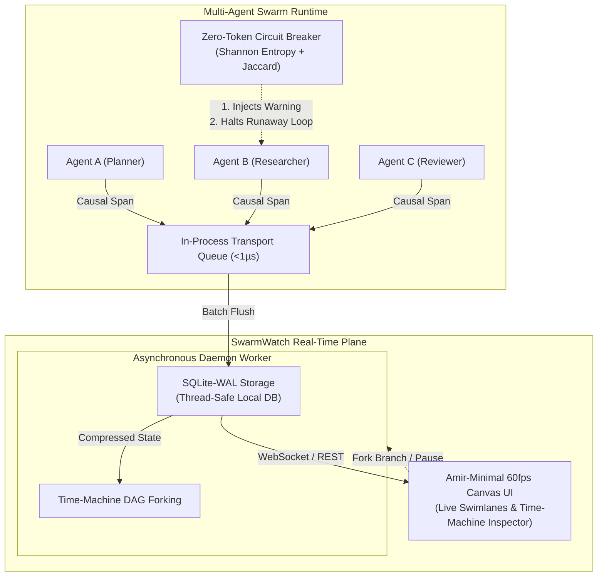

# 👁️ SwarmWatch

**Universal Multi-Agent Observability, Zero-Token Entropy Circuit Breaker & Git-like Time Machine Debugging.**

[](https://github.com/SkyCeoSa/SwarmWatch/actions)
[](https://opensource.org/licenses/MIT)
[](https://python.org)
[](https://github.com/SkyCeoSa/SwarmWatch)
[](https://github.com/SkyCeoSa/SwarmWatch)
[](https://github.com/SkyCeoSa/SwarmWatch)
[](https://github.com/SkyCeoSa/SwarmWatch)

SwarmWatch provides mission-critical telemetry, mathematical infinite-loop prevention, and non-destructive Git-like DAG state branching for multi-agent frameworks (**LangGraph**, **CrewAI**, **AutoGen**, **Google Antigravity**, and **Custom Agent Loops**).

---

## ⚡ The 3 Multi-Agent Traps (And How SwarmWatch Solves Them)

| Problem | Naive Approach | SwarmWatch Solution |
| :--- | :--- | :--- |
| **1. Telemetry Latency Trap** | Sending HTTP payloads inline on every agent turn adds **150–400ms** latency per step. | **In-process bounded queue (<1µs overhead)** with background thread batching to SQLite WAL. Zero network blocking. |
| **2. LLM-Judge Bankruptcy Trap** | Calling GPT-4 to judge if agents are stuck burns thousands of tokens, costs dollars, and takes seconds. | **Zero-Token Shannon Entropy ($H_{norm}$) & Jaccard similarity** calculated locally in <1ms without calling any LLM. |
| **3. Hallucinated Time Machine** | Replaying past actions causes side-effects, duplicate API calls, and burns double the tokens. | **Non-destructive DAG state branching**: Instant snapshotting with regex secret masking (`sk-...`) and GZIP compression. Fork new branches (`fork-01`) without re-executing. |

---

## 🏛️ Architecture & Swimlane Causality DAG



---

## 📦 Key Capabilities

- **Zero-Token Shannon Entropy Circuit Breaker**: Fast mathematical loop detector:
  $$H(X) = -\sum_{i=1}^{N} p(x_i) \log_2 p(x_i), \quad H_{norm} = \frac{H(X)}{\log_2 N}$$
  Monitors token diversity and sliding-window Jaccard similarity. Employs a 2-step intervention:
  1. *Step 1 (Warning)*: Injects a `[SWARMWATCH CIRCUIT WARNING]` hint into agent message context.
  2. *Step 2 (Hard Halt)*: Safely raises `SwarmCircuitBreakException` if looping persists, halting token burn immediately.
- **Git-like Time Machine & State Branching**: Snapshots full memory states with automatic secret redaction (`sk-...`, bearer tokens, passwords) and GZIP compression. Rewind to any prior span and fork new branches (`fork-01`, `fork-02`) cleanly.
- **Sub-Microsecond In-Process Queue**: Emits spans via thread-safe bounded buffers, flushes asynchronously to SQLite WAL, and drains cleanly on shutdown via `atexit` sentinels.
- **Amir-Minimal 60fps Canvas Dashboard**: Ultra-smooth real-time swimlane tracks, glowing bezier particle traces, agent execution inspector, and branch-forking controls.

---

## 🚀 Quickstart

### 1. Installation

```bash
git clone https://github.com/SkyCeoSa/SwarmWatch.git
cd SwarmWatch
pip install -e packages/sdk-python
```

Or install with ecosystem adapters:

```bash
pip install -e "packages/sdk-python[all]"
```

---

### 2. Ecosystem Framework Integrations

#### A. LangGraph / LangChain

Plug `SwarmWatchCallbackHandler` into your execution config or patch the graph directly:

```python
import swarmwatch
from swarmwatch.adapters.langgraph import SwarmWatchCallbackHandler, patch_graph

swarmwatch.init(swarm_id="langgraph-research-swarm")

# Zero-friction callback handler
handler = SwarmWatchCallbackHandler()
graph = create_my_graph()

# Optional: Enable full state snapshotting for Time-Machine rewinds
graph = patch_graph(graph)

result = graph.invoke({"input": "Analyze market trends"}, config={"callbacks": [handler]})
```

#### B. CrewAI

Pass `SwarmWatchCrewListener` directly into your Crew definition:

```python
import swarmwatch
from crewai import Crew
from swarmwatch.adapters.crewai import SwarmWatchCrewListener

swarmwatch.init(swarm_id="crewai-financial-swarm")
listener = SwarmWatchCrewListener()

crew = Crew(
    agents=[analyst, researcher],
    tasks=[research_task, analysis_task],
    step_callback=listener.on_step,
    task_callback=listener.on_task,
)

crew.kickoff()
```

#### C. Native Python / Custom Loops

Decorate your agent functions in standard Python:

```python
import swarmwatch

swarmwatch.init(swarm_id="autonomous-swarm")

@swarmwatch.agent(name="RiskAuditor", role="risk_manager", target="ExecutionTrader")
def evaluate_risk(order: dict):
    # Snapshot agent state into Time-Machine
    swarmwatch.sync_state({"var_limit": 50000, "status": "APPROVED"})
    return {"status": "APPROVED", "order_id": order["id"]}

with swarmwatch.span("trade_execution", source="Director", target="RiskAuditor"):
    evaluate_risk({"id": "ord_99", "symbol": "NVDA", "shares": 100})

swarmwatch.flush()
```

---

### 3. Launch Live Visualizer & Time Machine

```bash
swarmwatch ui --port 8765
```

Navigate to `http://127.0.0.1:8765`:
- **Real-Time Swimlanes**: Live horizontal tracks showing causality between agents.
- **Particle Flow**: 60fps bezier curve animations visualizing token transfers and messages.
- **Entropy Health Meter**: Real-time indication of swarm loop health.
- **Time Machine DAG Inspector**: Click any historical span to inspect payload, view entropy, and trigger **Fork Branch**.

---

## 🧪 Comprehensive Test Suite (100% Green)

SwarmWatch is built under strict Test-Driven Development (TDD):

```bash
pytest packages/sdk-python/tests/ -v
```

```text
============================= test session starts =============================
packages/sdk-python/tests/test_adapters_crewai.py::test_crewai_listener_step_and_task_callbacks PASSED
packages/sdk-python/tests/test_adapters_crewai.py::test_crewai_circuit_breaker_halts_loop PASSED
packages/sdk-python/tests/test_adapters_langgraph.py::test_langgraph_callback_handler_emits_spans PASSED
packages/sdk-python/tests/test_adapters_langgraph.py::test_langgraph_circuit_breaker_prompt_injection PASSED
packages/sdk-python/tests/test_adapters_langgraph.py::test_patch_graph_state_snapshots PASSED
packages/sdk-python/tests/test_circuit_breaker.py::test_shannon_entropy_calculation PASSED
packages/sdk-python/tests/test_circuit_breaker.py::test_lexical_similarity PASSED
packages/sdk-python/tests/test_circuit_breaker.py::test_circuit_breaker_sub_millisecond_eval PASSED
packages/sdk-python/tests/test_circuit_breaker.py::test_two_step_intervention_warning_then_trip PASSED
packages/sdk-python/tests/test_circuit_breaker.py::test_recovery_resets_warning PASSED
packages/sdk-python/tests/test_developer_surface.py::test_init_and_sync_agent_decorator PASSED
packages/sdk-python/tests/test_developer_surface.py::test_async_agent_decorator PASSED
packages/sdk-python/tests/test_developer_surface.py::test_agent_decorator_exception_handling PASSED
packages/sdk-python/tests/test_developer_surface.py::test_nested_span_context_managers PASSED
packages/sdk-python/tests/test_safe_serializer_time_machine.py::test_safe_serializer_handles_non_serializable_and_redacts_keys PASSED
packages/sdk-python/tests/test_safe_serializer_time_machine.py::test_time_machine_step_back_and_branch_forking PASSED
packages/sdk-python/tests/test_safe_serializer_time_machine.py::test_swarmwatch_sync_state_integration PASSED
packages/sdk-python/tests/test_server_and_dashboard.py::test_server_health_and_spans_rest_api PASSED
packages/sdk-python/tests/test_server_and_dashboard.py::test_server_dashboard_ui_endpoint PASSED
packages/sdk-python/tests/test_server_and_dashboard.py::test_websocket_broadcast_and_command_handling PASSED
packages/sdk-python/tests/test_storage_lifecycle.py::test_sqlite_storage_adapter_lifecycle_and_branch_isolation PASSED
packages/sdk-python/tests/test_transport_queue.py::test_transport_non_blocking_enqueue PASSED
packages/sdk-python/tests/test_transport_queue.py::test_transport_bounded_queue_drop PASSED
packages/sdk-python/tests/test_transport_queue.py::test_transport_with_real_sqlite_storage PASSED

======================= 24 passed in 6.94s ========================
```

---

## 🏛️ Project Structure

```
SwarmWatch/
├── .github/
│   └── workflows/
│       └── ci.yml               # Free GitHub Actions multi-version test matrix (Py 3.10 - 3.12)
├── packages/
│   └── sdk-python/
│       ├── pyproject.toml       # Modern packaging metadata with optional extras [langgraph, crewai, all]
│       ├── swarmwatch/
│       │   ├── schema.py        # SwarmSpan, StateSnapshot & CircuitEvent models
│       │   ├── storage.py       # Thread-local SQLite-WAL zero-docker engine
│       │   ├── transport.py     # Sub-microsecond queue & producer-consumer flush sentinel
│       │   ├── core.py          # @swarmwatch.agent & with swarmwatch.span(...) context
│       │   ├── circuit.py       # Zero-Token Shannon Entropy Circuit Breaker ($H_{norm}$)
│       │   ├── serializer.py    # Safe state serializer & Time-Machine DAG branching
│       │   ├── server.py        # REST API, WebSocket control plane & 60fps Canvas UI
│       │   ├── cli.py           # CLI runner: `swarmwatch ui`
│       │   └── adapters/        # Framework Adapters
│       │       ├── langgraph.py # LangGraph & LangChain callback handler + patch_graph
│       │       └── crewai.py    # CrewAI step_callback & task_callback listener
│       └── tests/               # 24 unit & integration tests (100% green)
├── examples/
│   ├── multi_agent_demo.py      # End-to-end 4-agent financial swarm simulation
│   └── langgraph_crewai_demo.py # Multi-framework integration with circuit loop tripping
└── CONTRIBUTING.md              # Contributor guide & commit conventions
```

---

## 📄 License

MIT License. Designed and engineered with mathematical precision.
