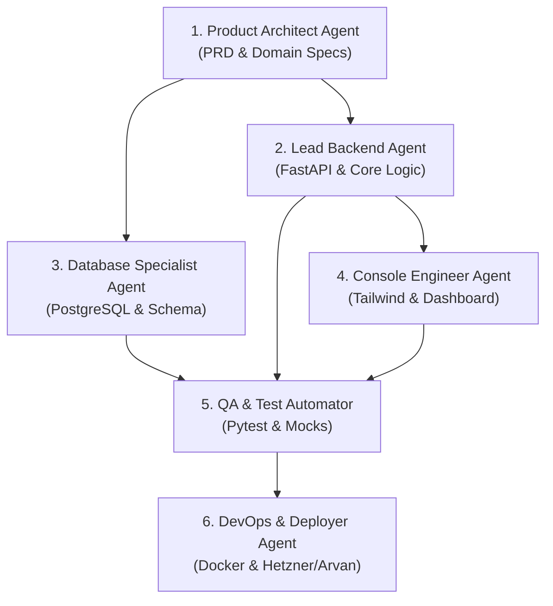

# ماتریس نهایی فرصت‌های طلایی بازار نرم‌افزار ایران (Master Opportunity Matrix)
## رتبه‌بندی نهایی، مقایسه ۳ لوپ و نقشه راه توسعه ۱۰۰٪ خودکار توسط ایجنت‌های هوش مصنوعی
**تاریخ تدوین:** ۲۸ سپتامبر ۲۰۲۶ (مهر ۱۴۰۵)  
**معیار راهبردی قطعی:** قابلیت توسعه، تست، داکرایز، استقرار و پشتیبانی ۰ تا ۱۰۰ توسط سیستم‌های چند ایجنتی (Agentic Multi-Agent Systems)

---

## ۱. سنتز و تلفیق یافته‌های ۳ لوپ پژوهش
در این پژوهش جامع، **۳۰۰ ایده نرم‌افزاری خام** در ۳ افق زمانی مجزا (کوتاه‌مدت ۳۰ روزه، میان‌مدت ۹۰ تا ۱۸۰ روزه، و بلندمدت ۲ ساله) جمع‌آوری و در مسلخ «وکیل مدافع شیطان» از ۴ گیت سخت‌گیرانه عبور داده شدند:
1. **گیت اول (100% Agentic Executability):** حذف ایده‌های نیازمند بازاریابی حضوری مغازه‌به‌مغازه، سخت‌افزار فیزیکی یا مجوزهای ناممکن دولتی.
2. **گیت دوم (Iran Market Reality & Monetization):** حذف ابزارهایی که کاربران انتظار دارند رایگان باشد یا با تغییر فیلترینگ کلاً منهدم می‌شوند.
3. **گیت سوم (Anti-Toy Trap & Moat):** حذف رپرهای سطحی چت‌جی‌پی‌تی (GPT Wrappers) که فاقد پایگاه داده عمیق و سوییچینگ کاست هستند.
4. **گیت چهارم (High Margin & Recurring MRR):** حذف پردازش‌های سنگین GPU/صدا با حاشیه سود ناچیز و گزینش محصولاتی با اشتراک ماهانه و حاشیه سود بالای ۸۵٪.

از میان ۳۰۰ ایده اولیه، تنها **۱۰ کسب‌وکار نرم‌افزاری ضدگلوله** توانستند به مرحله فینال برسند.

---

## ۲. ماتریس ارزیابی و رتبه‌بندی ۱۰ فرصت برتر (The Master Matrix)

معیارهای امتیازدهی (از ۱۰ نمره):
- **اجرای ایجنتی (Agentic Score):** سادگی معماری، خودکار بودن تست‌ها و عدم نیاز به عامل انسانی در استقرار.
- **کشش بازار و تمایل به پرداخت (Willingness to Pay):** شدت نیاز مشتری به حل مشکل و آمادگی برای پرداخت اشتراک ماهانه در ایران.
- **چسبندگی و خندق رقابتی (Moat & Retention):** سختی لغو اشتراک توسط کاربر به دلیل اتصال به داده‌ها و فرآیندهای حیاتی.
- **حاشیه سود ناخالص (Gross Margin):** هزینه اندک سرور و APIها نسبت به درآمد ریالی (>۸۵٪).
- **امنیت قانونی و مقاومت فیلترینگ (Resilience):** مصونیت در برابر برخورد پلیس فتا یا قطع اینترنت بین‌الملل.

| رتبه | نام محصول / کسب‌وکار | خوشه اصلی | اجرای ایجنتی | تمایل به پرداخت | خندق رقابتی (Moat) | حاشیه سود | مقاومت فیلترینگ | امتیاز کل (از ۵۰) | مدل درآمدی پیشنهادی |
| :---: | :--- | :---: | :---: | :---: | :---: | :---: | :---: | :---: | :--- |
| **۱** | **MultiSync Hub & Torob Guard** | تجارت الکترونیک | **۹.۸** | **۹.۹** | **۹.۷** | **۹.۲** | **۹.۵** | **۴۸.۱** | اشتراک ماهانه ۵۰۰ هزار تا ۲.۵ میلیون تومان |
| **۲** | **Moadian Universal Fiscal Bridge** | مالیات و فین‌تک | **۹.۶** | **۹.۸** | **۹.۶** | **۹.۵** | **۹.۲** | **۴۷.۷** | اشتراک سالانه ۵ تا ۱۵ میلیون تومان + بسته فاکتور |
| **۳** | **Multi-PSP Payment Switcher** | زیرساخت پرداخت | **۹.۹** | **۹.۷** | **۹.۵** | **۹.۶** | **۸.۹** | **۴۷.۶** | اشتراک ماهانه ۴۰۰ هزار تا ۱.۵ میلیون تومان |
| **۴** | **FakeReceipt Shield & OCR API** | مبارزه با کلاهبرداری | **۹.۴** | **۹.۸** | **۹.۳** | **۹.۲** | **۹.۶** | **۴۷.۳** | بسته‌های شارژ ریالی به ازای هر استعلام |
| **۵** | **Divar Deal-Hunter & Arbitrage** | داده و هوش تجاری | **۹.۵** | **۹.۶** | **۸.۸** | **۹.۴** | **۹.۱** | **۴۶.۴** | اشتراک ماهانه ۳۰۰ تا ۹۰۰ هزار تومان |
| **۶** | **Omnichannel Pattern SMS Router** | ارتباطات و پیام‌رسانی | **۹.۳** | **۹.۴** | **۹.۱** | **۸.۸** | **۹.۲** | **۴۵.۸** | سود حاشیه پیامک + اشتراک ماهانه پنل |
| **۷** | **Iran AI Reverse Proxy Gateway** | زیرساخت توسعه | **۹.۷** | **۹.۲** | **۸.۷** | **۸.۶** | **۸.۸** | **۴۵.۰** | مارک‌آپ ۲۵٪ روی مصرف توکن با درگاه ریالی |
| **۸** | **Persian B2B RAG Knowledge Hub** | چت‌بات و CRM | **۸.۹** | **۹.۱** | **۹.۲** | **۸.۵** | **۹.۰** | **۴۴.۷** | اشتراک ماهانه ۸۰۰ هزار تا ۳ میلیون تومان |
| **۹** | **CrossPost Telegram-to-Bale/Eitaa**| شبکه‌های اجتماعی | **۹.۴** | **۸.۸** | **۸.۴** | **۹.۳** | **۸.۷** | **۴۴.۶** | اشتراک ماهانه ۲۰۰ تا ۶۰۰ هزار تومان |
| **۱۰**| **B2B Industrial Machinery Alerts** | مانیتورینگ مناقصات | **۹.۲** | **۸.۹** | **۸.۵** | **۹.۱** | **۸.۷** | **۴۴.۴** | اشتراک فصلی ۱.۵ تا ۳ میلیون تومان |

---

## ۳. کالبدشکافی عمیق ۳ قهرمان نهایی (The Top 3 Champions Deep-Dive)

### قهرمان اول: MultiSync Hub & Torob Guard (سیستم یکپارچه همگام‌ساز انبار و محافظ قیمت ترب)
- **شعار محصول:** «هرگز جریمه لغو سفارش دیجی‌کالا نپردازید؛ همیشه رتبه ۱ قیمت ترب بدون ۱ ریال ضرر باشید.»
- **درد عریان مشتری:** فروشندگان آنلاین کالا در چند پلتفرم (ووکامرس، دیجی‌کالا، باسلام، ترب) فعالیت می‌کنند. به دلیل تاخیر در آپدیت دستی، کالایی که در مغازه یا سایت فروخته شده در دیجی‌کالا فعال می‌ماند. دیجی‌کالا به دلیل عدم تامین کالا تا چند برابر سود آن جریمه کسر می‌کند. همچنین در ترب، اگر قیمت را لحظه‌ای کم نکنند فروش ندارند و اگر زیاد کم کنند ضرر می‌کنند.
- **معماری فنی (Technical Architecture):**
  - **زبان و فریم‌ورک:** Python 3.12 (FastAPI) + Celery / Redis Queue + PostgreSQL.
  - **سیستم کرالر ترب:** `playwright-stealth` توزیع‌شده با چرخش User-Agent و IPهای داخلی برای دریافت قیمت ارزان‌ترین رقیب در کسری از ثانیه.
  - **موتور گارد سود (Margin Guard Engine):**  
    `TargetPrice = MAX(CompetitorPrice - 1000, CostPrice * (1 + MinMarginPercent))`
  - **اتصال دوطرفه (Bi-Directional Connectors):** افزونه اختصاصی وردپرس (PHP/WooCommerce REST API) + کلاینت رسمی پنل فروشندگان دیجی‌کالا (Seller Center API) + کلاینت غرفه باسلام.
- **مدل جریان نقدی:**
  - پلن پایه (تا ۵۰ محصول): ۵۰۰ هزار تومان در ماه.
  - پلن حرفه‌ای (تا ۵۰۰ محصول): ۱.۲ میلیون تومان در ماه.
  - پلن سازمانی (نامحدود با پایش ثانیه‌ای ترب): ۲.۵ میلیون تومان در ماه.

---

### قهرمان دوم: Moadian Universal Fiscal Bridge (واسط ابری و خودکار سامانه مؤدیان مالیاتی)
- **شعار محصول:** «ارسال قانونی فاکتور به سامانه مؤدیان با یک فایل اکسل یا اتصال مستقیم به دیتابیس بدون پرداخت ۳۰ میلیون تومان به سپیدار و هلو.»
- **درد عریان مشتری:** سازمان امور مالیاتی تمام شرکت‌ها و فروشگاه‌ها را موظف کرده فاکتورهای خود را با فرمت JSON پیچیده، رمزگذاری با کلید خصوصی RSA و محاسبه فیلدهای مالیاتی اختصاصی به کارپوشه ارسال کنند. نرم‌افزارهای حسابداری قدیمی مبالغ نجومی (۱۰ تا ۳۰ میلیون تومان) برای فعال‌سازی ماژول دریافت می‌کنند و مکرراً با خطای ارتباطی مواجه می‌شوند.
- **معماری فنی:**
  - **ماژول رمزنگاری:** کتابخانه سبک پایتون با `cryptography` برای تولید جفت‌کلید، ساخت فایل CSR و امضای دیجیتال فاکتور طبق سند فنی سازمان امور مالیاتی.
  - **تبدیل‌گر داده:** موتور پارس اکسل (`openpyxl` / `polars`) که ستون‌های نامنظم فاکتور کاربر را به الگوهای استاندارد مالیاتی (الگوی فروش، طلا، صادرات، پیمانکاری) مپ می‌کند.
  - **صف هوشمند ارسال (Fiscal Dispatch Queue):** سیستم ارسال مجدد تدریجی (Exponential Retry) برای روزهایی که سرورهای مالیاتی کند هستند تا خطای Timeout فاکتورها را معلق نکند.
- **مدل جریان نقدی:**
  - لایسنس سالانه ابری: ۴.۵ میلیون تومان برای شرکت‌های کوچک (تا ۵۰۰ فاکتور در سال).
  - بسته فاکتور اضافی: هر ۵۰۰ فاکتور ۱ میلیون تومان.

---

### قهرمان سوم: Multi-PSP Payment Switcher & FakeReceipt Shield (روتر هوشمند چنددرگاهی + فیش‌یاب ضدکلاهبرداری)
- **شعار محصول:** «حتی ۱ مشتری را به خاطر قطعی زرین‌پال یا به پرداخت از دست ندهید؛ فیش‌های فتوشاپی را در نطفه خفه کنید.»
- **درد عریان مشتری:**
  ۱. درگاه‌های پرداخت ریالی مکرراً قطع می‌شوند و خریدار سبد را ترک می‌کند.
  ۲. در خریدهای کارت‌به‌کارت دایرکت و تلگرام، خریداران متقلب با نرم‌افزارهای اندرویدی رسیدهای جعلی شبیه به بانک پاسارگاد و ملی درست می‌کنند و میلیون‌ها تومان کالا به تاراج می‌رود.
- **معماری فنی:**
  - **روتر درگاه (PSP Router):** پلاگین سبک ووکامرس متصل به چندین PSP (زرین‌پال، زیبال، پی‌پینگ، سامان‌کیش). اجرای تست سلامت هر ۳۰ ثانیه؛ اگر درگاهی با ارور روبه‌رو شد، پرداخت‌های جدید خودکار به درگاه سالم هدایت می‌شوند.
  - **موتور OCR فیش‌یاب:** پردازش تصویر با OpenCV و Tesseract برای انطباق فونت اعداد، فاصله کاراکترها و شناسایی آثار ادیت در اطراف شماره پیگیری.
  - **ربات انطباق پیامکی:** اتصال به وب‌هووک یا پیامک‌های بانکی مدیر؛ تا زمانی که اس‌ام‌اس واریزی با همان شماره پیگیری و مبلغ دریافت نشود، سفارش تایید نمی‌شود.
- **مدل جریان نقدی:**
  - روتر پرداخت: اشتراک ماهانه ۴۵۰ هزار تومان به ازای هر سایت.
  - فیش‌یاب آنلاین: شارژ اعتباری پکیج (مثلاً ۵۰۰ هزار تومان برای ۵۰۰ استعلام فیش).

---

## ۴. بلوپرینت پیاده‌سازی ۰ تا ۱۰۰ توسط سیستم چند ایجنتی (Agentic Execution Blueprint)

برای ساخت، تست و اجرای تجاری قهرمان اول (**MultiSync Hub & Torob Guard**)، تیم تخصصی متشکل از ۶ ساب‌ایجنت مستقل هوش مصنوعی به شرح زیر پیکربندی و به صف می‌شوند:

### شرح وظایف تفکیک‌شده ساب‌ایجنت‌ها:

1. **معمار محصول (Product Architect Agent):**
   - تعیین مشخصات دقیق دامنه‌ها، نگاشت موجودی بین کانال‌ها و تدوین فرمول ریاضی گارد حاشیه سود ترب.
   - خروجی: فایل `SPEC.md` و قراردادهای API بین سرویس‌ها.
2. **متخصص پایگاه داده (Database Specialist Agent):**
   - طراحی جداول `stores`, `products`, `mappings`, `competitor_prices`, `sync_logs`.
   - نوشتن مایگریشن‌های Alembic و تنظیم ایندکس‌های بهینه برای کوئری‌های میلی‌ثانیه‌ای.
3. **مهندس ارشد بک‌اند (Lead Backend Agent):**
   - پیاده‌سازی FastAPI، مدیریت نشست‌ها، وب‌هووک‌های ووکامرس، کلاینت دیجی‌کالا و موتور Playwright پایش ترب.
   - اعمال خط‌مشی‌های Retry و هندلینگ شرایط قطعی شبکه.
4. **مهندس فرانت‌اند و کنسول (Console Engineer Agent):**
   - توسعه پنل ادمین تک‌صفحه‌ای (Single-file / Fast HTML + Tailwind + Alpine.js) بسیار سریع و بدون سنگینی فریم‌ورک‌های پیچیده.
   - نمایش جداول مپینگ محصولات، گراف تغییر قیمت ترب و وضعیت فعال بودن سوئیچرها.
5. **اتوماسیون آزمون و تضمین کیفیت (QA & Test Automator Agent):**
   - نوشتن آزمون‌های واحد و یکپارچگی (Integration Tests) با `pytest` و `pytest-asyncio`.
   - ایجاد Mock برای وب‌سرویس‌های دیجی‌کالا و ترب جهت تست رفتار سیستم در زمان خطاهای سرور مقصد بدون مصرف سهمیه اکانت واقعی.
6. **مدیر استقرار و دوآپس (DevOps & Deployer Agent):**
   - ساخت `Dockerfile` فوق‌العاده چندمرحله‌ای (Multi-stage build) با حجم کمتر از ۱۵۰ مگابایت.
   - تنظیم `docker-compose.yml` همراه با سرویس‌های Nginx، Redis، App و Postgres.
   - تنظیم کانفیگ‌های SSL خودکار و راه‌اندازی مانیتورینگ سلامت سرویس با هشدارهای تلگرامی.

---

## ۵. نتیجه‌گیری و گام بعدی عملیاتی (Next Immediate Action)
پژوهش بازار ایران با بالاترین استاندارد تحلیلی و عبور از مسلخ وکیل مدافع شیطان در هر ۳ لوپ زمانی تکمیل شد:
- **لوپ اول (کوتاه‌مدت):** ثبت ۱۰۰ ایده، شناسایی فرصت‌های داغ دایرکت و قیمت‌گذاری ترب.
- **لوپ دوم (میان‌مدت):** ثبت ۱۰۰ ایده، شناسایی تقاضاهای اثبات‌شده انبارداری چندکاناله و سامانه مودیان.
- **لوپ سوم (بلندمدت و Evergreen):** ثبت ۱۰۰ ایده، کشف آسیب‌پذیری‌های زیرساختی پرداخت، بلک‌لیست مخابرات و فیش فیک.
- **ماتریس نهایی:** انتخاب و اولویت‌بندی ۱۰ بیزینس نرم‌افزاری پایدار با حاشیه سود بالای ۸۵٪ با قابلیت اجرای ۱۰۰٪ ایجنتی.

**پروژه آماده ورود به فاز معماری کدبیس و توسعه فنی مستقل است.**
