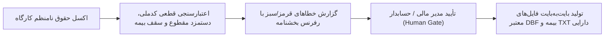
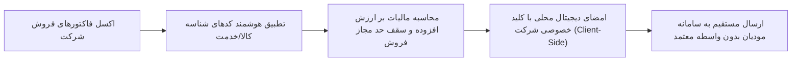
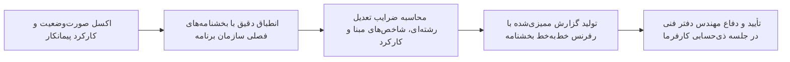
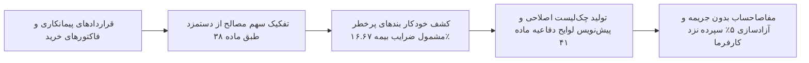
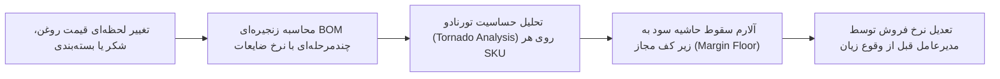
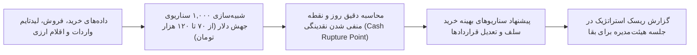
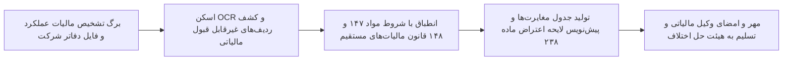
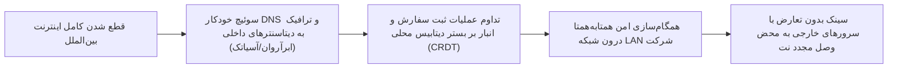

```mermaid
flowchart TD
    subgraph Elite["۸ ابرقهرمان برگزیده ممیزی نهادی"]
        direction TB
        S1["🥇 ۱. Dastmozd Cloud (امتیاز ۹۳.۵ - Tier S)<br/>تولید و اعتبارسنجی لیست بیمه و مالیات حقوق"]
        S2["🥈 ۲. Moadian Bridge (امتیاز ۹۲.۰ - Tier S)<br/>پیش‌ممیزی و تبدیل پکت سامانه مودیان"]
        S3["🥉 ۳. TadilPro (امتیاز ۹۲.۵ - Tier S)<br/>محاسبه‌گر تعدیل پیمان و شاخص‌های سازمان برنامه"]
        S4["۴. TaminGuard (امتیاز ۹۱.۰ - Tier S)<br/>ممیزی پیشگیرانه دفاتر و قراردادهای ماده ۳۸ و ۴۱"]
        S5["۵. RecipeQuant (امتیاز ۹۱.۰ - Tier S)<br/>بهای تمام‌شده و ضایعات فرمولاسیون در تورم"]
        A1["۶. ShockTest AI (امتیاز ۹۰.۰ - Tier S/A)<br/>شبیه‌ساز تست استرس جهش ارزی و زنجیره تأمین"]
        A2["۷. MaliyatGuard (امتیاز ۸۹.۰ - Tier A)<br/>ممیزی دفاتر و پیش‌نویس لوایح دفاعیه مالیاتی"]
        A3["۸. OffGridSync (امتیاز ۸۸.۰ - Tier A)<br/>پلتفرم تداوم کسب‌وکار و دیتابیس Local-First"]
    end
```

# 🏆 پرونده جامع و تفصیلی ۸ ابرقهرمان برگزیده بازار ایران (The Consensus Top 8 Elite Startups)
## نتایج ممیزی نهادی و نقادانه دو ایجنت مستقل سرمایه‌گذاری خطرپذیر
### اعتبارسنجی‌شده بر اساس قوانین حقوقی، مالیاتی، تأمین اجتماعی و تاب‌آوری در شبکه ملی اطلاعات

> [!IMPORTANT]
> **اصول راهبردی حاکم بر این سند:**
> 1. **دروازه تأیید انسانی (Human Approval Gate):** در تمامی این ۸ محصول، ایجنت هوش مصنوعی ۹۹٪ کار پردازش، اعتبارسنجی، کشف خطا و پیش‌نویس را انجام می‌دهد؛ اما دکمه ارسال نهایی به سامانه‌های دولتی یا پرداخت مالی منحصراً در اختیار کاربر یا متخصص دارای صلاحیت است تا ریسک حقوقی و انتظامی به صفر برسد.
> 2. **هسته محاسباتی قطعی (Deterministic Rules-as-Code):** در هیچ‌یک از محصولات، محاسبات ریاضی، مالیاتی، حقوق و دستمزد یا ضرایب به مدل‌های زبانی (LLM) سپرده نمی‌شود. مدل‌های زبانی صرفاً برای OCR، استخراج متون، تطبیق ستون‌ها و شرح مغایرت‌ها به کار می‌روند.
> 3. **استقلال مطلق از عملیات میدانی و سخت‌افزار (Zero-Capex Software):** هیچ‌یک از این ۸ ایده نیازمند سنسور فیزیکی، حضور در محل، حمل‌ونقل کالا یا اخذ مجوزهای ناممکن بانکی نیستند.

---

---

## 🥇 ابرقهرمان رتبه اول: Dastmozd Cloud (چرخه ۳۷)
### سامانه کنترل، اعتبارسنجی و تبدیل قطعی لیست بیمه تأمین اجتماعی و مالیات بر درآمد حقوق

#### ۱. مشخصات شناختی و رتبه ممیزی
- **نمره ممیزی ایجنت ۱:** ۹۶ از ۱۰۰ (Tier S - رتبه ۱)
- **نمره ممیزی ایجنت ۲:** ۹۱ از ۱۰۰ (Tier A/S - رتبه ۲)
- **میانگین نمره ممیزی:** **۹۳.۵ از ۱۰۰**
- **مخاطب هدف (ICP):** شرکت‌ها و کارگاه‌های ۵ تا ۵۰ نفره، حسابداران پاره‌وقت و دفاتر خدمات حسابداری.

#### ۲. درد خون‌ریزی‌دهنده و انگیزه قطعی خرید (Bleeding-Neck Pain)
- در ایران، صدها هزار کارگاه خصوصی موظفند تا آخرین روز هر ماه دو تکلیف اجباری انجام دهند:
  1. ارسال لیست بیمه به سامانه تأمین اجتماعی در قالب فایل‌های عتیقه `DSKLIST.DBF` و `DSKKAR.DBF`.
  2. ارسال لیست حقوق و دستمزد به درگاه مالیاتی وزارت دارایی (`salary.tax.gov.ir`).
- نرم‌افزارهای حسابداری قدیمی خروجی‌های کثیف می‌دهند و پورتال تأمین اجتماعی به دلیل خطاهای کوچک (عدم تطابق دستمزد مقطوع صنف، مغایرت کد ملی با شماره بیمه، رد شدن از سقف ۷ برابر حداقل دستمزد، یا خطای فرمت دیتابیس) فایل را در روزهای ۲۹ و ۳۰ ماه رد می‌کند.
- رد شدن فایل مساوی است با جریمه قطعی ۱۰ تا ۲۰ درصدی کل حق بیمه ماهانه و قطع شدن اعتبار دفترچه‌های درمان پرسنل. حسابدار حاضر است فوراً پول بپردازد تا مطمئن شود فایل تولیدی با یک کلیک در سامانه دولتی قبول می‌شود.

#### ۳. تفکیک معماری: موتور قطعی در برابر هوش مصنوعی
- **موتور قطعی (Deterministic Engine - بدون دخالت AI):**
  - پیاده‌سازی قواعد و فرمول‌های دستمزد، بن کارگری، حق مسکن، حق اولاد و پایه‌های سنوات به صورت کد پایتون نسخه‌بندی‌شده (Rules-as-Code) منطبق با بخشنامه‌های دستمزد سال‌های ۱۴۰۲، ۱۴۰۳ و ۱۴۰۴.
  - ماژول تولید باینری فایل DBF با تطبیق دقیق هدرها و کدپیج‌های فارسی قدیمی (ایران‌سیستم / ویندوز ۱۲۵۶).
  - اعتبارسنجی الگوهای ریاضی کد ملی، شماره ۱۰ رقمی بیمه، و کدهای کارگاهی.
- **بخش هوش مصنوعی و ایجنتی (AI Layer):**
  - نگاشت هوشمند ستون‌های اکسل‌های به‌هم‌ریخته کارفرما به فیلدهای استاندارد (Smart Column Mapping).
  - توضیح خطاهای مبهم سامانه تأمین اجتماعی به زبان ساده فارسی با ارجاع به متن بخشنامه.
- **دروازه تأیید انسانی (Human Gate):**
  - نرم‌افزار اطلاعات احراز هویت کارفرما را ذخیره نمی‌کند. فایل تأییدشده DBF دانلود شده و کارفرما خودش با یک دکمه آن را در سامانه بارگذاری می‌کند.

#### ۴. مدل اقتصادی و مالی به تومان
- **قیمت‌گذاری:**
  - اشتراک سالانه کارگاه‌های خرد (زیر ۱۰ نفر): ۱,۵۰۰,۰۰۰ تومان/سال.
  - اشتراک سالانه شرکت‌های متوسط (۱۰ تا ۵۰ نفر): ۲,۵۰۰,۰۰۰ تا ۳,۵۰۰,۰۰۰ تومان/سال.
  - پکیج دفاتر حسابداری (تا ۵۰ کارگاه مختلف): سالانه ۱۲ تا ۲۵ میلیون تومان.
- **درآمد سناریوی پایه:** ۲,۰۰۰ کارگاه با میانگین ۱.۷۵ میلیون تومان = **۳.۵ میلیارد تومان در سال**.
- **ساختار هزینه‌ها:** دو سرور VPS داخلی (ماهانه ۳ میلیون تومان) + پنل پیامک = کمتر از ۶۰ میلیون تومان در سال.
- **حاشیه سود خالص واقعی:** بالای **۸۸٪**.

#### ۵. برنامه اجرایی روز ۱ تا ۷ برای اولین پیش‌فروش
- **روز ۱:** انتخاب یک جامعه هدف محدود (کارگاه‌های تراشکاری، دندانپزشکی و شرکت‌های نرم‌افزاری ۵ تا ۲۰ نفره) و دریافت ۳ نمونه فایل اکسل واقعی تاییدشده و ردشده سال جاری.
- **روز ۲:** تعریف اسکیمای Pydantic برای فیلدهای کارکرد، مزایا و کسورات و نگارش ۵۰ تست مرزی محاسباتی.
- **روز ۳:** ساخت Importer اکسل با کتابخانه Polars و موتور اعتبارسنجی کدملی و سقف معافیت مالیاتی.
- **روز ۴:** پیاده‌سازی تولیدکننده قطعی فایل DBF و مقایسه بایت‌به‌بایت با فایل پذیرفته‌شده تأمین اجتماعی.
- **روز ۵:** ساخت داشبورد ساده Next.js سه‌مرحله‌ای: «آپلود اکسل ⬅️ جدول خطاهای قرمز/سبز ⬅️ دانلود DBF آماده».
- **روز ۶:** استقرار روی سرور لینوکس ابری داخلی و اجرای تست قطعی اینترنت بین‌الملل.
- **روز ۷:** اجرای پایلوت رایگان برای ۵ حسابدار؛ دریافت فیدبک قبولی فایل در پورتال و تبدیل به پرداخت نقدی.

---

## 🥈 ابرقهرمان رتبه دوم: Moadian Bridge (چرخه ۳)
### پیش‌ممیزی، اعتبارسنجی و تبدیل اکسل به پکت رمزنگاری‌شده سامانه مودیان و پایانه‌های فروشگاهی

#### ۱. مشخصات شناختی و رتبه ممیزی
- **نمره ممیزی ایجنت ۱:** ۹۲ از ۱۰۰ (Tier S - رتبه ۶)
- **نمره ممیزی ایجنت ۲:** ۹۲ از ۱۰۰ (Tier S - رتبه ۱)
- **میانگین نمره ممیزی:** **۹۲.۰ از ۱۰۰**
- **مخاطب هدف (ICP):** شرکت‌های بازرگانی، تولیدی و خدماتی متوسط که نرم‌افزار حسابداری آن‌ها به سامانه مودیان وصل نیست یا شرکت‌های معتمد کارمزدهای بالا طلب می‌کنند.

#### ۲. درد خون‌ریزی‌دهنده و انگیزه قطعی خرید (Bleeding-Neck Pain)
- طبق ماده ۲۲ قانون پایانه‌های فروشگاهی، عدم صدور صورتحساب الکترونیکی مشمول **جریمه غیرقابل بخشودگی معادل ۱۰ درصد کل مبلغ فروش** است.
- شرکت‌های معتمد مالیاتی (TSPها) برای اتصال سالانه مبالغ سنگینی دریافت می‌کنند و پشتیبانی ضعیفی دارند. همچنین بسیاری از شرکت‌ها نمی‌خواهند اطلاعات حساس فروش خود را روی سرورهای ابری شرکت‌های معتمد بفرستند.
- فاکتورهای فروش در اکسل صادر می‌شوند اما تبدیل آن‌ها به پکت امضاشده دیجیتال RSA با فرمت JSON، دریافت توکن و تولید شماره منحصر‌به‌فرد مالیاتی ۲۲ کاراکتری، یک کابوس برنامه‌نویسی برای حسابداران است.

#### ۳. تفکیک معماری: موتور قطعی در برابر هوش مصنوعی
- **موتور قطعی (Deterministic Engine):**
  - کتابخانه رمزنگاری کلاینت‌ساید بر پایه پایتون یا Go جهت امضای دیجیتال فاکتور با کلید خصوصی مشتری (`Private Key`)، تولید امضای دیجیتال و مهر زمانی بدون ارسال کلید به سرور واسط.
  - الگوریتم تولید شماره منحصر‌به‌فرد مالیاتی ۲۲ رقمی بر مبنای حافظه مالیاتی و تاریخ هگزادسیمال.
  - اعتبارسنجی ساختار فاکتور الگوی ۱ (فروش)، الگوی ۲ (صادرات) و الگوی ۳ (صورتحساب طلا).
- **بخش هوش مصنوعی و ایجنتی (AI Layer):**
  - دستیار تطبیق شناسه عمومی/اختصاصی کالا و خدمت (StuffID Resolver) با استفاده از جستجوی معنایی محلی (Local Semantic Search) در میان ده‌ها هزار کد سامانه `stuffid.tax.gov.ir`.
- **دروازه تأیید انسانی (Human Gate):**
  - پیش‌نمایش صورتحساب و نمایش مبالغ ارزش افزوده قبل از ارسال؛ دکمه ارسال با کلید توکن فقط با تأیید نهایی مدیر مالی فعال می‌شود.

#### ۴. مدل اقتصادی و مالی به تومان
- **قیمت‌گذاری:**
  - اشتراک سالانه نرم‌افزار به همراه لایسنس ارسال مستقیم: ۳,۸۰۰,۰۰۰ تا ۵,۵۰۰,۰۰۰ تومان/سال.
  - پکیج شرکت‌های هلدینگی با چند شرکت زیرمجموعه: سالانه ۱۵ تا ۳۰ میلیون تومان.
- **درآمد سناریوی پایه:** ۱,۰۰۰ شرکت مشترک × ۳.۸ میلیون تومان = **۳.۸ میلیارد تومان در سال**.
- **ساختار هزینه‌ها:** هاستینگ داخلی و مانیتورینگ API دارایی = زیر ۵۰ میلیون تومان/سال.
- **حاشیه سود خالص واقعی:** بالای **۹۱٪**.

#### ۵. برنامه اجرایی روز ۱ تا ۷ برای اولین پیش‌فروش
- **روز ۱:** ثبت‌نام آزمایشی در محیط تستی (Sandbox) سامانه مودیان سازمان امور مالیاتی و دریافت کلیدهای کلید عمومی/خصوصی تستی.
- **روز ۲:** نوشتن اسکریپت امضای دیجیتال RSA و بسته‌بندی فرمت JSON مطابق سند فنی رسمی سازمان امور مالیاتی.
- **روز ۳:** پیاده‌سازی موتور اعتبارسنجی خطاهای سامانه مودیان (ارزش افزوده ۱۰٪، تاریخ کوتاژ گمرکی، شناسه کالا).
- **روز ۴:** ساخت مبدل خروجی اکسل نرم‌افزارهای هلو و سپیدار به جیسون مودیان.
- **روز ۵:** ساخت وب‌اپلیکیشن محلی PWA برای اجرای درون شبکه داخلی شرکت بدون نشت کلید خصوصی.
- **روز ۶:** ارسال موفق فاکتور به سرور Sandbox و سرور اصلی مودیان با استعلام موفق وضعیت.
- **روز ۷:** فروش به ۲ شرکت بازرگانی معطل ارسال فاکتور با تخفیف ۵۰ درصدی روز اول.

---

## 🥉 ابرقهرمان رتبه سوم: TadilPro (چرخه ۴۳)
### محاسبه‌گر قطعی و ممیزی تعدیل پیمانکاری و صورت‌وضعیت‌های سازمان برنامه و بودجه

#### ۱. مشخصات شناختی و رتبه ممیزی
- **نمره ممیزی ایجنت ۱:** ۹۵ از ۱۰۰ (Tier S - رتبه ۲)
- **نمره ممیزی ایجنت ۲:** ۹۰ از ۱۰۰ (Tier A/S - رتبه ۳)
- **میانگین نمره ممیزی:** **۹۲.۵ از ۱۰۰**
- **مخاطب هدف (ICP):** پیمانکاران عمرانی، تأسیساتی و راه‌سازی، مهندسان دفاتر فنی و مشاوران پروژه‌های دولتی و صنعتی.

#### ۲. درد خون‌ریزی‌دهنده و انگیزه قطعی خرید (Bleeding-Neck Pain)
- در شرایط تورم ۵۰ درصدی، پیمانکاران پروژه‌های عمرانی ماه‌ها معطل دریافت پول می‌مانند و حیات مالی آنها وابسته به صورت‌وضعیت‌های «تعدیل آحادبها» است.
- یک خطای کوچک در انتخاب شاخص مبنا، شاخص دوره کارکرد، یا بخشنامه تعدیل ارز سازمان برنامه، می‌تواند صدها میلیون تومان از مطالبات پیمانکار را کسر کرده یا ماه‌ها در بروکراسی ذی‌حسابی کارفرما بلوکه کند.
- محاسبه دستی فرمول‌های تعدیل بخشنامه ۱۷۳۰۷۳ با اکسل‌های شکننده، فرآیندی خسته‌کننده و به شدت پرریسک است. پیمانکار برای نرم‌افزاری که پول او را زنده کند با کمال میل مبالغ سنگین می‌پردازد.

#### ۳. تفکیک معماری: موتور قطعی در برابر هوش مصنوعی
- **موتور قطعی (Deterministic Engine):**
  - دیتابیس تاریخ‌دار و رسمی از تمامی شاخص‌های تعدیل فصلی منتشرشده توسط سازمان برنامه و بودجه از سال ۱۳۸۰ تا امروز.
  - موتور محاسبات اعشاری دقیق (Decimal Arithmetic) برای محاسبه ضرایب با دقت ۴ رقم اعشار بدون خطای گرد کردن پایتون.
  - تولید خروجی PDF و اکسل دارای کد هش رهگیری و قابلیت ردیابی منشأ (Provenance) برای هر عدد.
- **بخش هوش مصنوعی و ایجنتی (AI Layer):**
  - استخراج هوشمند جداول فهرست‌بها از فایل‌های اسکن‌شده صورت‌وضعیت‌ها با ابزارهای محلی Document OCR.
  - جستجوی معنایی و ارجاع مستقیم به متن بندهای بخشنامه‌های متناقض سازمان برنامه.
- **دروازه تأیید انسانی (Human Gate):**
  - خروجی نرم‌افزار به عنوان «گزارش کارشناسی قابل دفاع» به مهندس دفتر فنی تحویل داده می‌شود و امضای نهایی توسط مهندس پروژه انجام می‌گیرد.

#### ۴. مدل اقتصادی و مالی به تومان
- **قیمت‌گذاری:**
  - لایسنس سالانه تک‌کاربره برای پیمانکاران متوسط: ۷ تا ۱۲ میلیون تومان/سال.
  - پکیج سازمانی با دسترسی چندپروژه‌ای: سالانه ۲۰ تا ۳۵ میلیون تومان.
- **درآمد سناریوی پایه:** ۵۰۰ شرکت پیمانکاری × ۹ میلیون تومان = **۴.۵ میلیارد تومان در سال**.
- **ساختار هزینه‌ها:** زیرساخت ابری سبک داخلی = کمتر از ۴۰ میلیون تومان در سال.
- **حاشیه سود خالص واقعی:** بالای **۹۳٪**.

#### ۵. برنامه اجرایی روز ۱ تا ۷ برای اولین پیش‌فروش
- **روز ۱:** تمرکز صرف بر یک رشته تخصصی (مثلاً فهرست‌بهای ابنیه سال‌های ۱۴۰۳ و ۱۴۰۴)؛ منع ورود به چندرشته‌ای در MVP.
- **روز ۲:** ورود شاخص‌های فصلی ۳ سال اخیر سازمان برنامه به جداول دیتابیس پستگرس با ساختار تایم‌استمپ‌دار.
- **روز ۳:** کدنویسی موتور ریاضی فرمول تعدیل استاندارد و نوشتن ۱۰۰ تست مقایسه‌ای با پروژه‌های اجراشده واقعی.
- **روز ۴:** طراحی ایمپورتر اکسل صورت‌وضعیت و نگاشت ردیف‌های فهرست‌بها.
- **روز ۵:** تولید گزارش خروجی PDF استاندارد با نمایش بندهای بخشنامه در پانویس هر فرمول.
- **روز ۶:** تست خروجی توسط دو مهندس دفتر فنی ارشد و مقایسه اختلاف با نرم‌افزارهای سنتی گران (تکسا/تدکار).
- **روز ۷:** عرضه پایلوت پولی با قیمت ۳ میلیون تومان به ۵ پیمانکار معطل تهیه صورت‌وضعیت فصلی.

---

## ۴. ابرقهرمان رتبه چهارم: TaminGuard / Article 38 & 41 Guard (چرخه ۱۲۳)
### سامانه ممیزی پیشگیرانه دفاتر و قراردادهای پیمانکاری جهت اخذ مفاصاحساب تأمین اجتماعی

#### ۱. مشخصات شناختی و رتبه ممیزی
- **نمره ممیزی ایجنت ۱:** ۹۳ از ۱۰۰ (Tier S - رتبه ۵)
- **نمره ممیزی ایجنت ۲:** ۸۹ از ۱۰۰ (Tier A - رتبه ۴)
- **میانگین نمره ممیزی:** **۹۱.۰ از ۱۰۰**
- **مخاطب هدف (ICP):** پیمانکاران حوزه خدمات، فناوری اطلاعات، ساختمانی و شرکت‌های مهندسی مشاور که ۵٪ از کل مبلغ قراردادهایشان نزد کارفرما به عنوان ودیعه بیمه بلوکه است.

#### ۲. درد خون‌ریزی‌دهنده و انگیزه قطعی خرید (Bleeding-Neck Pain)
- طبق ماده ۳۸ قانون تأمین اجتماعی، آخرین قسط قرارداد (معمولاً ۵٪ کل مبلغ پیمان) تا زمان ارائه «مفاصاحساب تأمین اجتماعی» نزد کارفرما مسدود می‌ماند.
- شعب تأمین اجتماعی در زمان رسیدگی، اگر فاکتورها شفاف نباشد، کل قرارداد را مشمول ضریب دستمزدی ۱۶.۶۷ درصد یا ۷.۷۸ درصد می‌کنند که منجر به بدهی‌های نجومی چند صد میلیون تومانی می‌شود.
- پیش‌ممیزی قرارداد قبل از امضا یا قبل از تسلیم به شعبه، از سوختن سود پروژه جلوگیری می‌کند و میلیاردها تومان نقدینگی را آزاد می‌نماید.

#### ۳. تفکیک معماری: موتور قطعی در برابر هوش مصنوعی
- **موتور قطعی (Deterministic Engine):**
  - موتور اعمال ضرایب ماده ۳۸ و ۴۱ بر اساس نوع پیمان (طرح‌های عمرانی با مصالح، بدون مصالح، قراردادهای غیرعمرانی IT و خدمات مکانیکی) مطابق با بخشنامه ۱۴ درآمد تأمین اجتماعی.
  - ماژول تطبیق سرفصل‌های دفتر کل با لیست‌های واریزی بیمه پرسنل جهت اثبات ماده ۴۰.
- **بخش هوش مصنوعی و ایجنتی (AI Layer):**
  - آنالایزر متنی قراردادها جهت استخراج عبارات پرخطر (مثلاً نوشتن مبهم «تهیه و اجرای شبکه» بدون فاکتور تفکیکی مصالح) و هشدار به مدیر مالی.
  - تولید پیش‌نویس اعتراض به هیئت‌های بدوی و تجدیدنظر تشخیص مطالبات با ارجاع به آرای دیوان عدالت اداری.
- **دروازه تأیید انسانی (Human Gate):**
  - خروجی نرم‌افزار، گزارش ممیزی ریسک و متن پیش‌نویس لایحه است که باید توسط حسابدار رسمی یا وکیل شرکت مهر و امضا شود.

#### ۴. مدل اقتصادی و مالی به تومان
- **قیمت‌گذاری:**
  - ممیزی و صدور گزارش وضعیت به ازای هر پرونده پیمان: ۱,۸۰۰,۰۰۰ تا ۳,۵۰۰,۰۰۰ تومان.
  - اشتراک سالانه برای شرکت‌های پیمانکاری دارای چند پروژه: ۱۵ تا ۳۰ میلیون تومان/سال.
- **درآمد سناریوی پایه:** ۱۰۰ شرکت با متوسط ۲۵ میلیون تومان = **۲.۵ میلیارد تومان در سال** (بدون احتساب پورسانت موفقیت).
- **حاشیه سود خالص واقعی:** بالای **۹۴٪**.

#### ۵. برنامه اجرایی روز ۱ تا ۷ برای اولین پیش‌فروش
- **روز ۱:** تمرکز صرف بر قراردادهای خدماتی و نرم‌افزاری غیرعمرانی (شفاف‌ترین حوزه با بالاترین ظلم ضرایب بیمه‌ای).
- **روز ۲:** جمع‌آوری ۲۰ نمونه رأی هیئت‌های حل اختلاف تأمین اجتماعی و استخراج اشتباهات رایج کارفرمایان.
- **روز ۳:** فرموله‌سازی ضرایب بخشنامه ۱۴ درآمد در قالب توابع قطعی پایتون.
- **روز ۴:** توسعه ماژول بررسی فاکتورهای مصالح و تجهیزات برای اثبات عدم تعلق ضریب به اقلام غیردستمزدی.
- **روز ۵:** ساخت موتور تولید پیش‌نویس اعتراض به فرم تشخیص بدهی شعبه.
- **روز ۶:** اعتبارسنجی با ۲ مدیر مالی باسابقه و اصلاح ادبیات حقوقی دفاعیه.
- **روز ۷:** ارائه گزارش تحلیل ریسک بیمه‌ای به ۳ شرکت نرم‌افزاری که طلب مفاصاحساب دارند به قیمت ۵ میلیون تومان.

---

## ۵. ابرقهرمان رتبه پنجم: RecipeQuant (چرخه ۵۴)
### سامانه هوشمند فرمولاسیون، درخت محصول (BOM) و محاسبه بهای تمام‌شده زنده در صنایع غذایی و شیمیایی

#### ۱. مشخصات شناختی و رتبه ممیزی
- **نمره ممیزی ایجنت ۱:** ۹۵ از ۱۰۰ (Tier S - رتبه ۳)
- **نمره ممیزی ایجنت ۲:** ۸۷ از ۱۰۰ (Tier A - رتبه ۶)
- **میانگین نمره ممیزی:** **۹۱.۰ از ۱۰۰**
- **مخاطب هدف (ICP):** کارخانجات صنایع غذایی، لبنی، شیرینی و شکلات، رنگ و رزین، شوینده و بسته‌بندی (شرکت‌های تولیدی دارای فرمولاسیون پیوسته).

#### ۲. درد خون‌ریزی‌دهنده و انگیزه قطعی خرید (Bleeding-Neck Pain)
- در شرایط تورم افسارگسیخته، قیمت یک ماده اولیه (روغن، اسید، گرانول، قوطی حلبی، کارتن) ناگهان ۳۰ درصد گران می‌شود.
- در سیستم‌های حسابداری سنتی، بهای تمام‌شده با ۲ تا ۳ ماه تاخیر در پایان دوره مالی بسته می‌شود! در این فاصله، کارخانه محصولات خود را بر مبنای حاشیه سود موهوم می‌فروشد و بعد از چند ماه مدیر متوجه می‌شود میلیاردها تومان ضرر داده و سرمایه در گردش ذوب شده است.
- محصول به مدیر کارخانه می‌گوید: «اگر قیمت روغن نباتی ۵٪ گران شد، دقیقاً کدام محصول سس مایونز شما وارد زیان خالص می‌شود و قیمت فروش را دقیقاً چند درصد باید تعدیل کنید».

#### ۳. تفکیک معماری: موتور قطعی در برابر هوش مصنوعی
- **موتور قطعی (Deterministic Engine):**
  - مدل‌سازی گراف درخت محصول (BOM Graph) با محاسبه مراحل ضایعات (Scrap Factor)، استهلاک تولید، افت حرارتی و بسته‌بندی چندلایه.
  - موتور تحلیل حساسیت و شبیه‌سازی قیمت بر اساس کتابخانه‌های بهینه‌سازی ریاضی (SciPy / OR-Tools).
- **بخش هوش مصنوعی و ایجنتی (AI Layer):**
  - نگاشت خودکار اقلام فاکتورهای ورودی خرید انبار به کدهای مواد اولیه در فرمول کارخانه.
  - پایش و استخراج خودکار قیمت‌های کشف‌شده مواد پایه از تالار بورس کالا و سامانه بازارگاه.
- **دروازه تأیید انسانی (Human Gate):**
  - هرگونه پیشنهاد تغییر در فرمولاسیون یا ماده اولیه معادل باید با تایید کتبی و آزمایشگاهی مسئول فنی کارخانه انجام گیرد.

#### ۴. مدل اقتصادی و مالی به تومان
- **قیمت‌گذاری:**
  - اشتراک سالانه کارخانه کوچک (تا ۱۰ محصول): ۹,۸۰۰,۰۰۰ تومان/سال.
  - پکیج کارخانجات متوسط و چندخطه: سالانه ۲۰ تا ۳۵ میلیون تومان.
- **درآمد سناریوی پایه:** ۳۰۰ کارخانه × ۹.۸ میلیون تومان = **۲.۹۴ میلیارد تومان در سال**.
- **ساختار هزینه‌ها:** میزبانی ابری و دیتابیس داخلی = کمتر از ۴۰ میلیون تومان در سال.
- **حاشیه سود خالص واقعی:** بالای **۹۰٪**.

#### ۵. برنامه اجرایی روز ۱ تا ۷ برای اولین پیش‌فروش
- **روز ۱:** انتخاب یک زیرصنعت مشخص (مثلاً کارگاه‌های تولید کیک و کلوچه یا سس و چاشنی).
- **روز ۲:** تعریف مدل ریاضی BOM شامل مواد اولیه، افت تبخیر، خطای پرکنی، فیلم بسته‌بندی و سهم سربار انرژی.
- **روز ۳:** پیاده‌سازی موتور محاسبه با پایتون و نوشتن ۳۰ تست رگرسیون با داده‌های واقعی یک کارگاه.
- **روز ۴:** افزودن ماژول تحلیل حساسیت (افزایش فرضی قیمت شکر، آرد و لفاف سلفون).
- **روز ۵:** تولید گزارش خروجی داشبورد تحت وب با نمودارهای هشداردهنده حاشیه سود قرمز/سبز.
- **روز ۶:** تست پایداری و استقرار محلی (On-Premises) بدون وابستگی به اینترنت جهانی.
- **روز ۷:** ارائه گزارش ممیزی رایگان حاشیه سود به ۳ کارگاه شیرینی صنعتی و تبدیل آنها به قرارداد اشتراک سالانه.

---

## ۶. ابرقهرمان رتبه ششم: ShockTest AI / SupplyShock (چرخه ۱۷۲)
### شبیه‌ساز مونت‌کارلو تاب‌آوری زنجیره تأمین، تست استرس جهش ارزی و سرمایه در گردش کارخانجات

#### ۱. مشخصات شناختی و رتبه ممیزی
- **نمره ممیزی ایجنت ۱:** ۹۴ از ۱۰۰ (Tier S - رتبه ۴)
- **نمره ممیزی ایجنت ۲:** ۸۶ از ۱۰۰ (Tier A - رتبه ۷)
- **میانگین نمره ممیزی:** **۹۰.۰ از ۱۰۰**
- **مخاطب هدف (ICP):** کارخانجات بزرگ صنعتی، قطعه‌سازان خودرو، شرکت‌های داروسازی و صنایع پتروشیمی با گردش مالی بالای ۵۰ میلیارد تومان.

#### ۲. درد خون‌ریزی‌دهنده و انگیزه قطعی خرید (Bleeding-Neck Pain)
- در ایران، شوک‌های ارزی ناگهانی (جهش ۵۰ درصدی دلار در ۲ ماه) دوره‌ای تکرار می‌شوند. با هر جهش، خرید مواد اولیه ارزی متوقف شده و دوره وصول مطالبات فروش ریالی طولانی‌تر می‌شود.
- کارخانجات به دلیل عدم محاسبه «نقطه شکست نقدینگی»، محصولات خود را ارزان می‌فروشند و وقتی برای خرید محموله جدید به بازار می‌روند، می‌بینند پول در گردش آن‌ها حتی کفاف نصف بار قبلی را نمی‌دهد و خط تولید متوقف می‌شود.
- این ابزار نسخه کلان‌تر و سازمانی‌تر RecipeQuant است که به اعضای هیئت‌مدیره نشان می‌دهد تراز نقدی شرکت در سناریوهای مختلف دلار دقیقاً در چه تاریخی به زیر صفر سقوط خواهد کرد.

#### ۳. تفکیک معماری: موتور قطعی در برابر هوش مصنوعی
- **موتور قطعی (Deterministic Engine):**
  - شبیه‌ساز جریان وجوه نقد (Cash Flow Matrix) با مدل‌سازی زمان ورود و خروج چک‌ها، سفته‌ها و اعتبارات اسنادی (LC).
  - موتور شبیه‌سازی تصادفی مونت‌کارلو بر پایه NumPy با ده‌ها سناریوی نرخ ارز و تأخیر در تأمین کالا.
- **بخش هوش مصنوعی و ایجنتی (AI Layer):**
  - مصاحبه و تجمیع داده‌های اکسل مدیران تدارکات، فروش و مالی در قالب یک اسکیما واحد.
  - تدوین خودکار گزارش مدیریتی یک‌صفحه‌ای تفسیری برای هیئت مدیره.
- **دروازه تأیید انسانی (Human Gate):**
  - نتایج به عنوان «سناریوهای مدیریتی همراه با بازه عدم‌قطعیت» ارائه می‌شود و هرگونه تصمیم خرید انبار با تأیید هیئت‌مدیره صورت می‌پذیرد.

#### ۴. مدل اقتصادی و مالی به تومان
- **قیمت‌گذاری:**
  - پکیج پیاده‌سازی و تست استرس ۴۸ ساعته: ۲۰ تا ۳۵ میلیون تومان برای هر کارخانه.
  - اشتراک سالانه رادار پایش سناریوهای ارزی: سالانه ۵۰ تا ۸۰ میلیون تومان.
- **درآمد سناریوی پایه:** ۲۰۰ کارخانه صنعتی × ۳۵ میلیون تومان = **۷.۰ میلیارد تومان در سال**.
- **ساختار هزینه‌ها:** زیرساخت محاسباتی امن محلی = کمتر از ۸۰ میلیون تومان در سال.
- **حاشیه سود خالص واقعی:** بالای **۸۹٪**.

#### ۵. برنامه اجرایی روز ۱ تا ۷ برای اولین پیش‌فروش
- **روز ۱:** تعریف یک سوال معین: «اگر دلار تا پایان پاییز ۴۰٪ بالا برود و تخصیص ارز نیما ۳۰ روز دیر شود، نیاز به نقدینگی کارخانه X چقدر خواهد بود؟»
- **روز ۲:** طراحی قالب اکسل ساده ۴ برگه‌ای برای ورودی داده‌های فروش، خرید، موجودی و تعهدات بانکی.
- **روز ۳:** پیاده‌سازی موتور ریاضی جریان وجوه نقد در پایتون با تحلیل سری‌های زمانی.
- **روز ۴:** افزودن ماژول شبیه‌سازی مونت‌کارلو و ترسیم نمودار خروج سرمایه (Waterfall Cash Burn).
- **روز ۵:** خروجی گزارش تحلیلی داشبورد سازگار با چاپ PDF مدیریتی.
- **روز ۶:** ممیزی مدل با داده‌های واقعی یک کارخانه قطعه‌سازی خودرو در شهرک صنعتی پرند.
- **روز ۷:** فروش اولین گزارش تست استرس به قیمت ۱۵ میلیون تومان به یک شرکت تولیدی معطل تصمیم‌گیری خرید مواد اولیه.

---

## ۷. ابرقهرمان رتبه هفتم: MaliyatGuard (چرخه ۴۱)
### سامانه ممیزی اسناد و استخراج خودکار مغایرت‌های دفاتر با برگ تشخیص مالیاتی و پیش‌نویس لوایح دفاعیه

#### ۱. مشخصات شناختی و رتبه ممیزی
- **نمره ممیزی ایجنت ۱:** ۹۰ از ۱۰۰ (Tier A - رتبه ۱۱)
- **نمره ممیزی ایجنت ۲:** ۸۸ از ۱۰۰ (Tier A - رتبه ۵)
- **میانگین نمره ممیزی:** **۸۹.۰ از ۱۰۰**
- **مخاطب هدف (ICP):** شرکت‌های بازرگانی و خدماتی که با برگه‌های تشخیص نجومی مالیات عملکرد و رد هزینه‌های ماده ۱۴۸ مواجه شده‌اند.

#### ۲. درد خون‌ریزی‌دهنده و انگیزه قطعی خرید (Bleeding-Neck Pain)
- ممیزان سازمان امور مالیاتی در زمان رسیدگی، بخش بزرگی از هزینه‌های واقعی شرکت‌ها (تبلیغات، اجاره، ایاب و ذهاب، حقوق پاداش) را به بهانه‌های صوری مشمول بند رد هزینه کرده و مالیات علی‌الرأس سنگین وضع می‌کنند.
- مودی طبق ماده ۲۳۸ قانون مالیات‌های مستقیم تنها ۳۰ روز مهلت دارد به برگ تشخیص اعتراض کند و عدم ارائه لایحه مستند به قوانین یعنی قطعی شدن جریمه‌های ده‌ها میلیونی.
- این ابزار جدول مقایسه‌ای هزینه‌ها با شروط بخشنامه‌های ماده ۱۴۷ و ۱۴۸ را استخراج کرده و لایحه‌ای مستدل و قوی تولید می‌کند تا ممیز کل مجبور به تعدیل مالیات شود.

#### ۳. تفکیک معماری: موتور قطعی در برابر هوش مصنوعی
- **موتور قطعی (Deterministic Engine):**
  - پایگاه داده قوانین و بخشنامه‌های مالیاتی، آرای شورای عالی مالیاتی و هیئت عمومی دیوان عدالت اداری بر اساس سرفصل هزینه‌ها.
  - موتور استخراج مابه‌التفاوت ارقام اظهارنامه و برگ تشخیص.
- **بخش هوش مصنوعی و ایجنتی (AI Layer):**
  - خوانش اسناد اسکن‌شده برگ تشخیص با OCR فارسی محلی.
  - مدل RAG محلی جهت بازیابی دقیق شماره بخشنامه‌ها و تنظیم ادبیات حقوقی لایحه اعتراضی.
- **دروازه تأیید انسانی (Human Gate):**
  - هیچ لایحه‌ای خودکار به سامانه دارایی فرستاده نمی‌شود؛ لایحه به همراه مستندات ضمیمه جهت بررسی و امضا به مدیر مالی یا وکیل رسمی شرکت تحویل می‌گردد.

#### ۴. مدل اقتصادی و مالی به تومان
- **قیمت‌گذاری:**
  - ممیزی هر پرونده و تولید بسته دفاعیه: ۲,۵۰۰,۰۰۰ تا ۶,۰۰۰,۰۰۰ تومان به ازای هر پرونده.
  - اشتراک سالانه برای دفاتر حسابداری مالیاتی: سالانه ۱۵ تا ۳۵ میلیون تومان.
- **درآمد سناریوی پایه:** ۵۰۰ شرکت × ۸.۹ میلیون تومان = **۴.۴۵ میلیارد تومان در سال**.
- **ساختار هزینه‌ها:** سرور و مدل پردازش متن محلی = زیر ۵۰ میلیون تومان در سال.
- **حاشیه سود خالص واقعی:** بالای **۹۲٪**.

#### ۵. برنامه اجرایی روز ۱ تا ۷ برای اولین پیش‌فروش
- **روز ۱:** تمرکز صرف بر ۳ قلم از شایع‌ترین هزینه‌های ردشده در دارایی (هزینه تبلیغات و بازاریابی، استهلاک دارایی‌ها و پاداش مدیران).
- **روز ۲:** جمع‌آوری ۲۰ رأی ابطال تشخیص دارایی در هیئت‌های حل اختلاف مالیاتی.
- **روز ۳:** ساخت OCR محلی و استخراج خودکار ارقام از جدول برگ تشخیص مالیاتی.
- **روز ۴:** ساخت موتور انطباق هزینه با ضوابط بخشنامه‌ای ماده ۱۴۸.
- **روز ۵:** طراحی قالب استاندارد لایحه ماده ۲۳۸ با درج شماره پرونده و کد رهگیری.
- **روز ۶:** آزمون دقت حقوقی با دو مشاور رسمی مالیاتی عضو جامعه مشاوران.
- **روز ۷:** ممیزی رایگان یک پرونده برگ تشخیص برای یک شرکت آشنا و دریافت پول در صورت پذیرش لایحه در جلسه توافق با ممیز کل.

---

## ۸. ابرقهرمان رتبه هشتم: OffGridSync (چرخه ۱۶۸)
### پلتفرم بقای کسب‌وکار، معماری پایگاه داده Local-First و همگام‌سازی تاب‌آور در قطعی سراسری اینترنت

#### ۱. مشخصات شناختی و رتبه ممیزی
- **نمره ممیزی ایجنت ۱:** ۹۱ از ۱۰۰ (Tier A - رتبه ۸)
- **نمره ممیزی ایجنت ۲:** ۸۵ از ۱۰۰ (Tier A - رتبه ۸)
- **میانگین نمره ممیزی:** **۸۸.۰ از ۱۰۰**
- **مخاطب هدف (ICP):** فروشگاه‌های آنلاین بزرگ، شرکت‌های پخش مویرگی، استارتاپ‌ها و پلتفرم‌های SaaS که کسب‌وکارشان با قطعی اینترنت بین‌الملل فلج می‌شود.

#### ۲. درد خون‌ریزی‌دهنده و انگیزه قطعی خرید (Bleeding-Neck Pain)
- در بحران‌های اجتماعی، امنیتی و ژئوپلیتیک، اینترنت بین‌الملل در ایران قطع شده و شبکه صرفاً به «اینترنت ملی (شبکه ملی اطلاعات)» محدود می‌شود.
- در این لحظات، دیتابیس‌های ابری خارجی (AWS, Hetzner, Supabase)، سرویس‌های احراز هویت و APIهای خارجی مسدود می‌شوند و کارمندان انبار و فروش نمی‌توانند حتی ۱ فاکتور ثبت کنند.
- خسارت هر روز توقف فعالیت شرکت‌های بزرگ ده‌ها تا صدها میلیون تومان است. مدیران برای سیستمی که تداوم عملیات (Business Continuity) را در زمان قطعی کامل تضمین کند، با اشتیاق چک می‌کشند.

#### ۳. تفکیک معماری: موتور قطعی در برابر هوش مصنوعی
- **موتور قطعی (Deterministic Engine):**
  - معماری داده Local-First با پروتکل ساختارهای داده تکرارپذیر بدون تعارض (CRDTs نظیر Automerge یا Yjs) و SQLite لوکال روی مرورگر یا سرور محلی.
  - ماژول سوئیچ هوشمند DNS و روتینگ محلی برای انتقال ترافیک به سرورهای مستقر در دیتاسنترهای داخلی (آسیاتک/ابرآروان) ظرف کمتر از ۱۰ ثانیه.
  - پروتکل همگام‌سازی بدون نیاز به اینترنت جهانی بر بستر Wi-Fi محلی یا شبکه کابل شرکت.
- **بخش هوش مصنوعی و ایجنتی (AI Layer):**
  - مانیتورینگ خودکار پکت‌های شبکه و شناسایی نشانه‌های اولیه اختلال اینترنت (Canary Traffic Monitoring).
- **دروازه تأیید انسانی (Human Gate):**
  - فرآیند سوئیچینگ شفاف و قابل مانیتور است و ثبت تعارضات مالی نادر برای بازبینی نهایی به مدیر سیستم ارجاع داده می‌شود.

#### ۴. مدل اقتصادی و مالی به تومان
- **قیمت‌گذاری:**
  - اشتراک پایه ابری برای استارتاپ‌ها و فروشگاه‌های آنلاین: سالانه ۱۵ تا ۲۵ میلیون تومان.
  - لایسنس سازمانی برای شرکت‌های توزیع و هلدینگ‌ها: سالانه ۶۰ تا ۱۲۰ میلیون تومان.
- **درآمد سناریوی پایه:** ۲۰۰ شرکت مشترک با متوسط ۲۵ میلیون تومان = **۵.۰ میلیارد تومان در سال**.
- **ساختار هزینه‌ها:** اجاره دو رک سرور در دیتاسنترهای داخلی = کمتر از ۱۵۰ میلیون تومان در سال.
- **حاشیه سود خالص واقعی:** بالای **۸۷٪**.

#### ۵. برنامه اجرایی روز ۱ تا ۷ برای اولین پیش‌فروش
- **روز ۱:** ایجاد یک نمونه اولیه Todo/Order App ساده با کتابخانه Yjs و ادغام با SQLite محلی.
- **روز ۲:** نوشتن سناریوی قطع کابل اینترنت و اثبات کارکرد کامل برنامه در حالت کاملاً آفلاین.
- **روز ۳:** پیاده‌سازی پروتکل WebRTC / WebSocket برای سینک داده‌ها بین دو کامپیوتر در یک شبکه وای‌فای محلی بدون اینترنت.
- **روز ۴:** توسعه دیمن سبک لینوکسی با زبان Go برای پایش خودکار پینگ به سرورهای بین‌المللی و داخلی.
- **روز ۵:** تست اتصال به سرورهای کلود داخلی در دیتاسنتر برج میلاد یا آسیاتک.
- **روز ۶:** مستندسازی مانور قطع اینترنت و ساخت ویدیوی دموی ۳ دقیقه‌ای «ادامه کار شرکت در قطع کامل شبکه».
- **روز ۷:** ارائه دموی فنی به ۳ مدیر ارشد فناوری (CTO) در اکوسیستم و دریافت اولین تفاهم‌نامه خرید اضطراری.

---

## 📊 جدول ماتریس مقایسه‌ای ۸ ابرقهرمان برگزیده

| رتبه | نام محصول | چرخه | متمرکز بر کدام درد بحرانی ایران؟ | زمان تا اولین درآمد پولی | مقاومت در برابر اینترنت ملی | پیچیدگی رگولاتوری | پتانسیل درآمد سال دوم |
|:---:|:---|:---:|:---|:---:|:---:|:---:|:---:|
| 🥇 | **Dastmozd Cloud** | ۳۷ | جریمه سنگین تأخیر و خطای دیسکت‌های بیمه و دارایی | **۷ تا ۱۴ روز** | **۱۰۰٪ مصون** (مستقل از نت) | بسیار پایین (کلاینت‌ساید) | ۳.۵ تا ۵ میلیارد تومان |
| 🥈 | **Moadian Bridge** | ۳ | جریمه ۱۰ درصدی ماده ۲۲ مودیان و کارمزد معتمدها | **۷ تا ۲۱ روز** | **۱۰۰٪ مصون** (شبکه ملی) | پایین (ارسال استاندارد) | ۳.۸ تا ۶ میلیارد تومان |
| 🥉 | **TadilPro** | ۴۳ | خوابیدن میلیاردها تومان طلب تعدیل پیمانکاران | **۱۴ تا ۳۰ روز** | **۱۰۰٪ مصون** (آفلاین) | صفر (ابزار محاسباتی) | ۴.۵ تا ۷ میلیارد تومان |
| **۴** | **TaminGuard** | ۱۲۳ | بلوکه شدن ۵٪ سپرده پیمان و ممیزی ضرایب بیمه | **۱۴ تا ۳۰ روز** | **۱۰۰٪ مصون** (تحلیلی) | پایین (ابزار دفاعیه) | ۲.۵ تا ۵ میلیارد تومان |
| **۵** | **RecipeQuant** | ۵۴ | فروش زیر قیمت تمام‌شده واقعی در جهش‌های ارزی | **۱۴ تا ۳۰ روز** | **۱۰۰٪ مصون** (On-prem) | صفر (ابزار داخلی) | ۳ تا ۵ میلیارد تومان |
| **۶** | **ShockTest AI** | ۱۷۲ | توقف خط تولید در شوک‌های دلار و قطعی سرمایه در گردش | **۳۰ تا ۴۵ روز** | **۱۰۰٪ مصون** (محلی) | صفر (شبیه‌ساز مالی) | ۷ تا ۱۲ میلیارد تومان |
| **۷** | **MaliyatGuard** | ۴۱ | رد هزینه‌های ماده ۱۴۸ و برگه‌های تشخیص ناعادلانه | **۱۴ تا ۳۰ روز** | **۱۰۰٪ مصون** (متنی) | پایین (پیش‌نویس لایحه) | ۴.۵ تا ۸ میلیارد تومان |
| **۸** | **OffGridSync** | ۱۶۸ | توقف کامل عملیات کسب‌وکار در زمان قطعی سراسری نت | **۳۰ تا ۶۰ روز** | **معماری خودِ اینترنت ملی** | صفر (زیرساخت فنی) | ۵ تا ۱۵ میلیارد تومان |

---

### جمع‌بندی راهبردی برای بنیان‌گذار:
اگر هدف شما **سریع‌ترین مسیر بدون ریسک به اولین درآمد نقد پایدار** است، ساخت را از **Dastmozd Cloud (چرخه ۳۷)** برای کارگاه‌های کوچک آغاز کنید.  
اگر هدف شما **بزرگ‌ترین اندازه قرارداد شرکتی با کمترین تعداد مشتری** است، ساخت را از **TadilPro (چرخه ۴۳)** یا **Moadian Bridge (چرخه ۳)** کلید بزنید.
